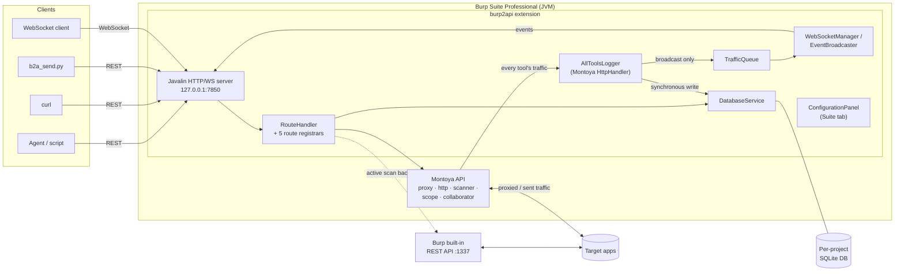
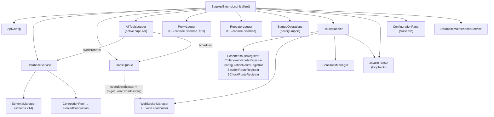
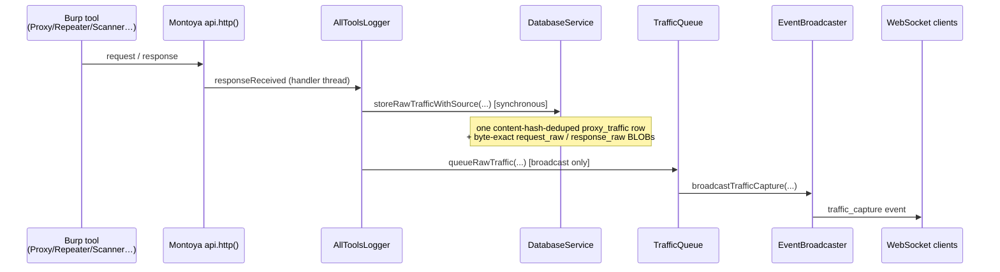
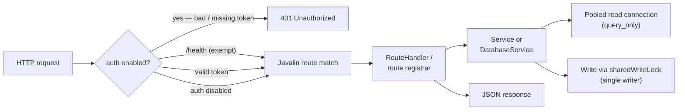
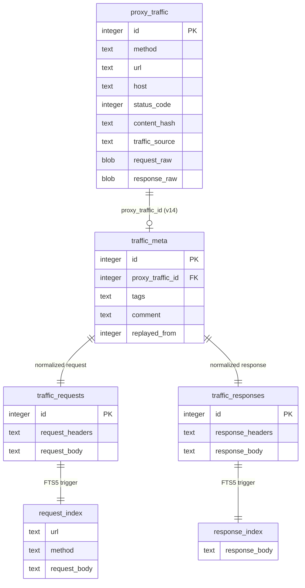
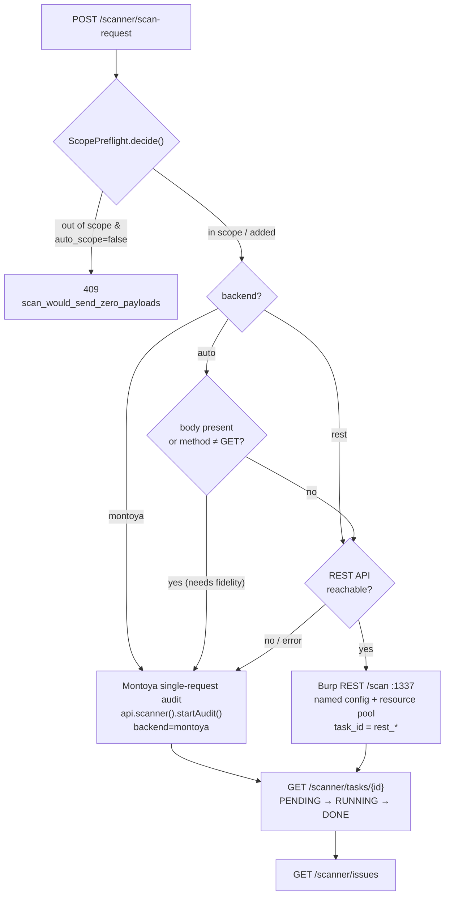

# burp2api Architecture

burp2api is an OpenJDK 21 Burp Suite Professional extension (entry point `com.burp2api.BurpApiExtension`) that exposes Burp's proxy, scanner, scope, session, and Collaborator workflows over a local REST and WebSocket API.

It runs **inside** a Burp Suite Professional JVM, talks to Burp through the Montoya API, serves its own HTTP/WebSocket API with an embedded [Javalin](https://javalin.io/) server bound to `127.0.0.1:7850` by default, and persists captured traffic in a per-project SQLite database. This document describes how the pieces fit together; the endpoint reference lives in [`README.md`](README.md).

## Component overview

The extension sits between API clients (an automated agent, a script, `curl`, `clients/b2a_send.py`, or a WebSocket consumer) and Burp's own tooling. Clients never touch Burp directly — every action is mediated by the extension, and all captured traffic is mirrored into the SQLite store so it survives Burp restarts.

## Startup and wiring

`BurpApiExtension.initialize(MontoyaApi)` builds the object graph in four ordered phases: core infrastructure (config, database, traffic queue), capture handlers, the API server and UI, then background maintenance and a one-shot proxy-history import. Each component is constructed once and handed its collaborators by the extension — there is no dependency-injection container.

## Traffic capture pipeline

Every tool's traffic (Proxy, Repeater, Intruder, Scanner, and requests the API itself sends) reaches `AllToolsLogger`, registered as a single Montoya `HttpHandler`. It is the **only** component that writes captures to the database, and it does so **synchronously on the Montoya handler thread** — one content-hash-deduplicated `proxy_traffic` row with byte-exact `request_raw`/`response_raw` BLOBs.

The `TrafficQueue` is used **only** to fan out live events to WebSocket subscribers, not for the durable write. `ProxyLogger` and `RepeaterLogger` exist but their DB-capture paths are disabled: an earlier design wrote each proxied transaction twice and, under concurrent traffic, the second (asynchronous, heuristically correlated) writer orphaned empty-bodied rows. Collapsing all capture onto the one synchronous writer removed those duplicates (#53).

## Request lifecycle

An inbound API request passes a timing-safe bearer-token check (skipped when no token is configured; `/health` is always exempt), matches a Javalin route owned by `RouteHandler` or one of the five registrars, and is served by a service or by `DatabaseService`. Reads take a pooled, per-thread read connection (`PRAGMA query_only=ON`); writes are serialized through a single `sharedWriteLock`, matching SQLite's single-writer model.

## Data model

Captured traffic lives in two linked halves. `proxy_traffic` holds the flattened, deduplicated row plus the raw wire BLOBs that serve as byte-exact evidence. A separate normalized side (`traffic_meta` + `traffic_requests`/`traffic_responses`, indexed by FTS5 virtual tables `request_index`/`response_index`) backs full-text body search and carries tags/comments.

The two halves were historically written under independent auto-increment counters and bridged only by `content_hash`. Schema **v14** added `traffic_meta.proxy_traffic_id`, an explicit link to the public `proxy_traffic.id` space so a body-search hit resolves to the exact captured instance and annotations land on the request the caller is looking at (#21, #28). The diagram is simplified to the core capture tables.

## Active scan backend selection

`POST /scanner/scan-request` first runs a scope preflight, because an out-of-scope Montoya audit is silently accepted but sends zero payloads. It then dispatches to one of two backends. The default (`backend=auto`) prefers Burp's built-in REST API (which can apply a named scan configuration and a resource pool) but falls back to a Montoya single-request audit when fidelity demands it (a request body or a non-GET method, which the REST `/scan` path cannot replay) or when the REST service is unreachable.

## Key design decisions

- **One synchronous DB writer.** `AllToolsLogger` owns all capture writes on the Montoya thread; the async queue is for WebSocket fan-out only. This trades a little handler-thread latency for a complete, non-duplicated, byte-exact record (#53).
- **Byte-exact evidence over projections.** Raw request/response bytes are stored in BLOB columns and served by `GET /proxy/history/{id}/raw`. The flattened `headers`/`body` columns are a best-effort search projection, not the citable evidence source.
- **One public id space.** Every read endpoint returns a `proxy_traffic.id`; the `traffic_meta.proxy_traffic_id` link (v14) keeps replay, tagging, and body-search results resolving to the same instance (#21, #28).
- **Pooled reads, serialized writes.** A connection pool leases per-thread read connections (`query_only`) so concurrent searches never share one JDBC `Connection`, while a single write lock respects SQLite's single-writer constraint (#52).
- **Reuse Burp's scan machinery.** Rather than rebuild a task engine, scans run through Burp's authoritative REST API or a Montoya audit, with pure mappers (`ScanStatusMapper`, `RestScanMapper`) normalizing both into one status vocabulary.
- **Safe by default.** The server binds loopback and leaves authentication off for local single-user use; binding to a non-loopback interface without a token logs a warning. Sensitive material (tokens, cookies, Collaborator secrets) is never written to disk or logs.
- **Durable, per-project store.** Each Burp project gets its own SQLite database (co-located beside the `.burp` file when detectable); nothing is pruned automatically, so the store is the durable record Burp's in-memory Logger tab is not.
